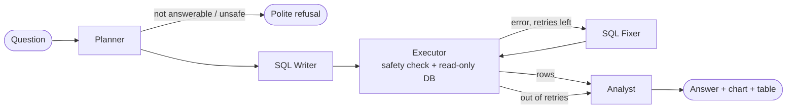

# Analyst Desk: Multi-Agent Text-to-SQL Data Analyst

Ask business questions in plain English ("Which category made the most profit last year?"). A team of AI agents built with **LangGraph** plans the analysis, writes SQL, **fixes its own SQL when it fails**, runs it safely on a read-only database, and explains the answer with a chart.

**Stack:** Python, LangGraph, LangChain, Groq (Llama 3.3 70B), SQLite, sqlglot, FastAPI, React, Recharts, Docker


---

## How it works



| Agent | Job |
|---|---|
| **Planner** | Decides whether the question can be answered from the data (refuses off-topic or data-changing requests) and picks the tables, joins and filters |
| **SQL Writer** | Writes one SQLite `SELECT` following the plan and shared business definitions (e.g. revenue excludes cancelled and returned orders) |
| **Executor** | Validates the SQL with the safety layer, runs it with a time limit, returns rows or the exact database error |
| **SQL Fixer** | Reads the error and the schema and rewrites the query; loops back to the Executor (max 3 retries) |
| **Analyst** | Turns the result into a 2–4 sentence answer and chooses a suitable chart (line for trends, bar for comparisons, pie for parts of a whole) |

The state machine lives in [`backend/app/agents/graph.py`](backend/app/agents/graph.py). Every step is recorded and shown in the UI under **"How the agents worked"**, including failed attempts and fixes.

### Safety (read-only by design)

1. **Parser check** ([sqlglot](https://github.com/tobymao/sqlglot)): exactly one statement, and it must be a `SELECT` (CTEs and `UNION` allowed).
2. **Keyword blocklist**: `INSERT`, `UPDATE`, `DELETE`, `DROP`, `ALTER`, `PRAGMA`, `ATTACH`, …
3. **Read-only connection**: SQLite is opened with `mode=ro`, so even a query that slipped past 1–2 could not change data.
4. **Limits**: automatic `LIMIT 200` and a 5-second query timeout.

---

## Evaluation

[`backend/eval/questions.jsonl`](backend/eval/questions.jsonl) has **52 questions**: 47 answerable ones with hand-written gold SQL (15 easy, 17 medium, 15 hard) and 5 that must be refused (deleting data, off-topic).

`eval/run_eval.py` runs every question through the full agent graph and compares the returned rows with the gold query's rows (column names ignored, row order ignored unless it matters, numeric tolerance).

Results with `openai/gpt-oss-120b` on Groq (November 2026):

| Metric | Result |
|---|---|
| **Execution accuracy** | **95.7%** (45 / 47) |
| Easy / Medium / Hard | 100% / 94.1% / 93.3% |
| First-try accuracy | 95.7% |
| Refusal accuracy (unsafe / off-topic) | 100% (5 / 5) |
| Average latency | 11.5 s per question |
| Average tokens | ~2,800 per question |

The SQL Fixer wasn't needed on this benchmark (every correct answer was right on the first try); the self-correction loop is covered by the unit tests in `tests/test_graph.py`.

```bash
cd backend
python eval/run_eval.py          # results -> eval/results/metrics.json
```

The evaluator itself is tested: feeding it the gold SQL scores 100%.

---

## Run it locally

**Needs:** Python 3.10+, Node 18+, and a free Groq API key from [console.groq.com/keys](https://console.groq.com/keys).

### Backend
```bash
cd backend
python -m venv .venv
.venv\Scripts\activate          # Windows  (macOS/Linux: source .venv/bin/activate)
pip install -r requirements.txt
copy .env.example .env          # macOS/Linux: cp .env.example .env
# open .env and paste your key: GROQ_API_KEY=gsk_...
python data/seed.py             # builds data/retail.db (demo store, 2024-2025)
uvicorn app.main:app --reload --port 8000
```

### Frontend (second terminal)
```bash
cd frontend
npm install
npm run dev                     # http://localhost:5173
```

### Tests
```bash
cd backend
pytest -q                       # uses a scripted fake LLM: no API key or network needed
```

---

## Deploy (one container)

The `Dockerfile` builds the React app and serves it together with the API.

```bash
docker build -t analyst-desk .
docker run -p 8000:8000 -e GROQ_API_KEY=gsk_... analyst-desk     # open http://localhost:8000
```

**Render (free):** New → Web Service → connect this repo → Runtime: Docker → add the environment variable `GROQ_API_KEY` → Deploy.

---

## The demo database

`data/seed.py` generates **ShopKart**, a fictional Indian online store (deterministic, so results are reproducible): 800 customers in 4 regions, 60 products in 6 categories, ~6,200 orders and ~10,300 order items from Jan 2024 to Dec 2025, with growth over time and an October–November festive-season spike. Point `DB_PATH` at your own SQLite file to analyse other data.

```
regions(region_id, region_name)
customers(customer_id, name, city, region_id, segment, signup_date)
products(product_id, product_name, category, unit_price, unit_cost)
orders(order_id, customer_id, order_date, status, channel, payment_method)
order_items(order_item_id, order_id, product_id, quantity, unit_price, discount_pct)
```

## Project structure

```
backend/
  app/
    agents/graph.py     LangGraph state machine: planner, writer, executor, fixer, analyst
    agents/prompts.py   agent prompts + shared business definitions
    safety.py           SQL guardrails (sqlglot + blocklist + LIMIT)
    db.py               read-only SQLite access, timeout, schema description
    llm.py              Groq / Gemini client, JSON and SQL extraction
    main.py             FastAPI: /api/ask, /api/sql, /api/schema
  data/seed.py          demo database generator
  eval/                 52 benchmark questions + evaluator
  tests/                pytest suite (fake LLM)
frontend/src/           React UI: question box, chart/table/SQL tabs, agent trace, schema panel
Dockerfile              single-container build
```

## License

MIT
